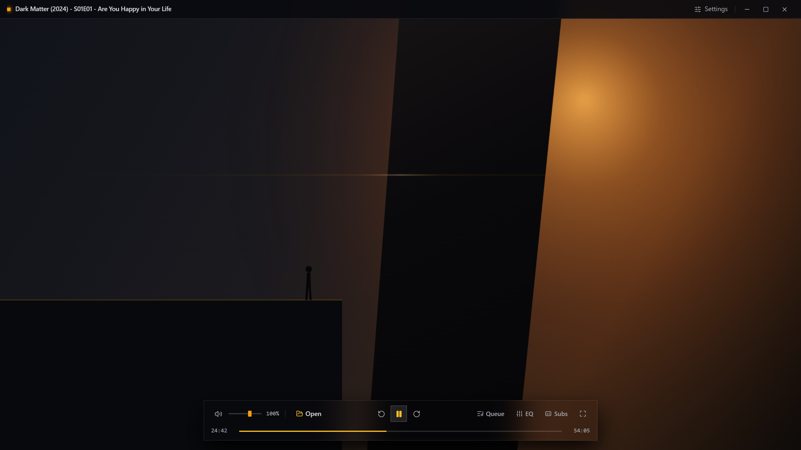
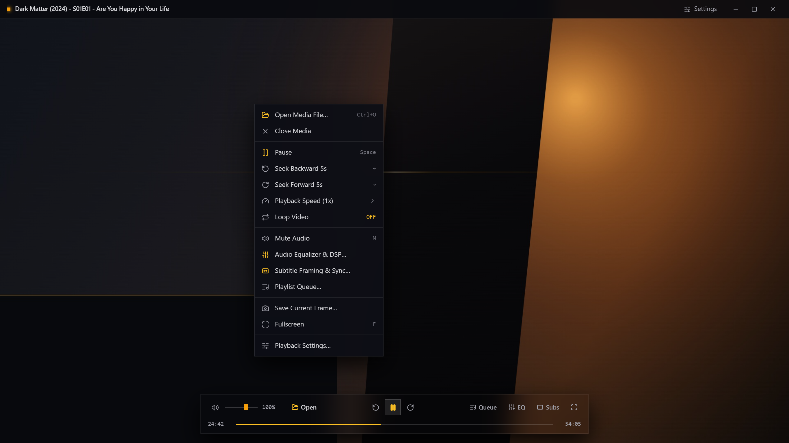
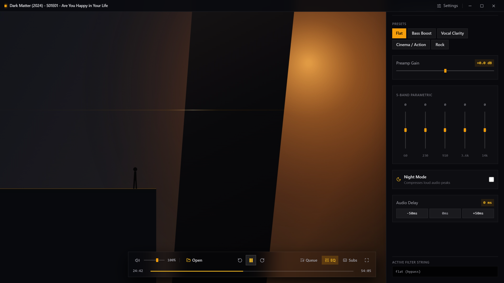
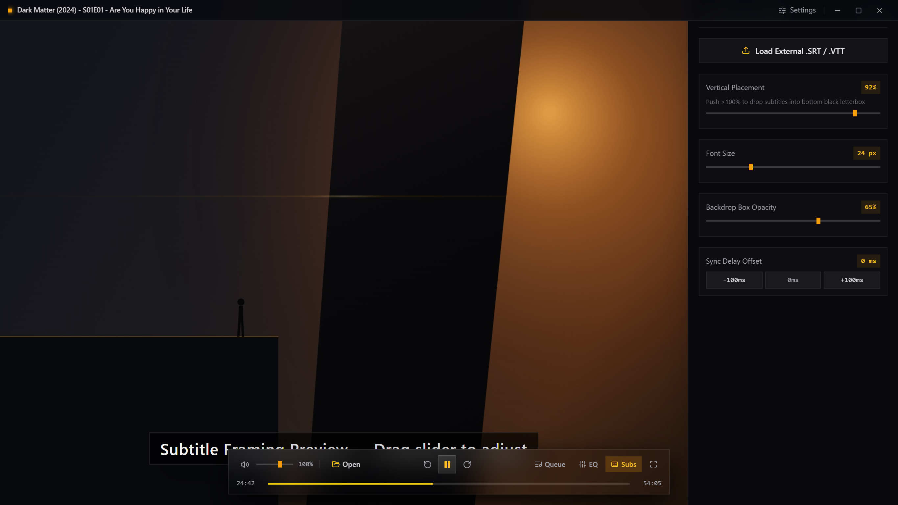
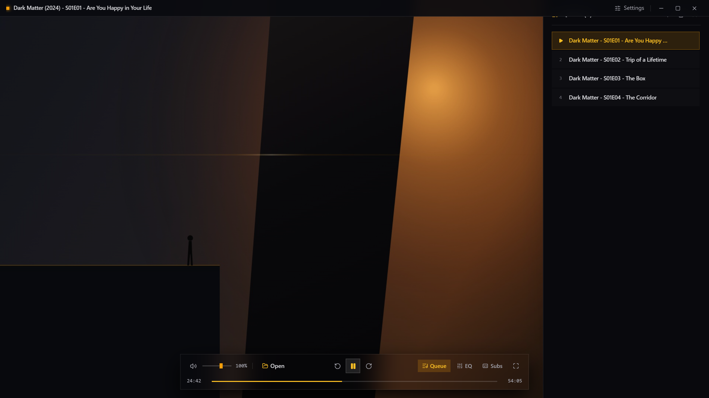
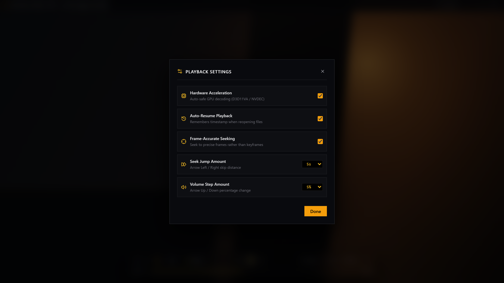

# MyPlayer Pro (Rust + Tauri v2)

A minimal, high-performance desktop media player built with **Tauri v2**, **Rust**, **React 18**, and **Tailwind CSS**.

Featuring a razor-sharp, obsidian-glass aesthetic, immediate autoplay, buttery-smooth 60fps timeline tracking, studio-grade 5-band audio equalization, and precision subtitle framing.

---

## UI Showcase

### 🎬 Main Playback Viewport & Obsidian Controls
> Razor-sharp, vertically compact playbar with sharp right angles, glassmorphism backdrop, 150% volume headroom, and custom frameless top window bar. Keyboard seeks update with discreet OSD toasts without interrupting cinema viewing.



---

### ⚡ Custom Obsidian Context Menu
> Full-featured right-click context menu offering instant playback speed selection, loop toggling, audio & subtitle drawers, frame snapshots, and fullscreen controls.



---

### 🎚️ 5-Band Parametric Audio Equalizer & DSP
> Real-time FFmpeg `lavfi` audio filter graph compilation in Rust, preamp gain (-12dB to +12dB), dynamic Night Mode compressor (tames loud explosions, boosts whisper dialogue), and audio sync calibration.



---

### 💬 Precision Subtitle Framing & Calibration
> Vertical placement slider (10% to 105%) that lets you frame subtitles directly into the bottom letterbox black bar, font scaling, backdrop box opacity, and millisecond delay sync.



---

### 📑 Reorderable Playlist Queue
> Slide-out queue drawer supporting drag-and-drop multi-file video loading, active playback indicators, track numbering, and quick track removal.



---

### ⚙️ Playback Settings & Hardware Acceleration
> Configurable GPU hardware decoding (`hwdec: auto-safe` via D3D11VA / NVDEC), frame-accurate precision seeking (`hr-seek`), auto-resume playback position memory, and configurable seek/volume step intervals.



---

## Key Highlights

- **Razor-Sharp Obsidian HUD**: Compact, vertically small playbar with zero bulky curved pills or emojis. Styled with translucent dark glassmorphism and subtle hairline borders.
- **Instant Direct Autoplay**: Videos start playing immediately upon opening, drag-and-dropping, or selecting from the playlist queue.
- **Buttery-Smooth 60fps Scrubbing**: Continuously synchronized playback clock powered by `requestAnimationFrame` for fluid timeline progression without discrete 250ms jumps.
- **Synchronous Fast-Forward & Rewind**: Dedicated instant seek handlers (±5s) that immediately advance the media clock with zero state batching delay.
- **5-Band Parametric Audio Equalizer**:
  - Live FFmpeg `lavfi` audio filter graph generation (`build_audio_filter` in Rust).
  - Preamp gain (-12dB to +12dB).
  - Night Mode dynamic range compressor (tames loud action peaks, boosts whisper dialogue).
  - Audio delay sync (-50ms / 0ms / +50ms calibration).
  - Built-in presets: *Flat*, *Bass Boost*, *Vocal Clarity*, *Cinema / Action*, *Rock*.
- **Subtitle Framing & Calibration**:
  - Vertical positioning slider (10% to 105%), allowing subtitles to be dropped directly into the bottom letterbox black bar.
  - Font scaling and backdrop box opacity.
  - Subtitle millisecond delay calibration.
  - Drag-and-drop external `.srt`, `.vtt`, and `.ass` parser.
- **Reorderable Playlist Queue**:
  - Drag-and-drop multiple video files into the queue.
  - Track numbering, current media indicator, and quick removal.
- **Playback Preferences & Hardware Acceleration**:
  - GPU hardware decoding (`hwdec: auto-safe` via D3D11VA / NVDEC).
  - Frame-accurate precision seeking (`hr-seek`).
  - Auto-resume playback position memory.

---

## Project Structure

```plaintext
my_player_rust/
├── package.json                                 # Frontend scripts & dependencies (Bun/Node)
├── tailwind.config.js                           # Tailwind CSS configuration
├── tsconfig.json                                # TypeScript configuration
├── vite.config.ts                               # Vite + React bundler configuration
│
├── src/                                         # FRONTEND: React 18 + TypeScript + Tailwind
│   ├── main.tsx                                 # React root entry point
│   ├── App.tsx                                  # App container
│   ├── index.css                                # Razor-sharp slider & typography CSS
│   ├── core/
│   │   ├── types.ts                             # TypeScript mirrors of Rust structs
│   │   └── tauriClient.ts                       # Typed IPC bridge calling Rust #[tauri::command]
│   └── features/
│       ├── player/
│       │   ├── PlayerScreen.tsx                 # Main viewport, gestures, keyboard shortcuts, autoplay
│       │   ├── TopWindowBar.tsx                 # Custom frameless window bar with drag region
│       │   ├── BottomControlsBar.tsx            # Vertically small right-angled transport bar
│       │   ├── OsdOverlay.tsx                   # Top-right obsidian glass toast
│       │   └── TrackPickerPopover.tsx           # Audio & subtitle stream selector
│       ├── audio/
│       │   └── EqualizerPanel.tsx               # 5-Band EQ, Preamp, Night Mode
│       ├── subtitles/
│       │   └── SubtitlePanel.tsx                # Subtitle framing, scale, sync
│       ├── playlist/
│       │   └── PlaylistPanel.tsx                # Queue drawer
│       └── settings/
│           └── PlaybackSettingsModal.tsx        # Hardware decoding & auto-resume modal
│
└── src-tauri/                                   # BACKEND: Rust Core + Tauri v2
    ├── Cargo.toml                               # Rust dependencies & build profiles
    ├── tauri.conf.json                          # Frameless window configuration & IPC permissions
    └── src/
        ├── main.rs                              # Desktop binary entry point
        ├── lib.rs                               # Tauri runtime handler registration
        ├── commands.rs                          # #[tauri::command] IPC endpoints
        ├── core/
        │   ├── time_formatter.rs                # Duration and seconds timestamp formatting
        │   └── title_cleaner.rs                 # Scene tag, codec, and year title stripper
        ├── data/
        │   └── models/
        │       ├── eq_state.rs                  # 5-Band EQ state & presets
        │       ├── subtitle_style.rs            # Subtitle framing configuration
        │       └── playback_preferences.rs      # Seek step & hardware acceleration options
        └── services/
            ├── audio_filter_builder.rs          # lavfi filter graph builder
            ├── mpv_properties.rs                # mpv property constant definitions
            ├── subtitle_service.rs              # Subtitle framing calibration service
            └── player_service.rs                # Backend player state & settings manager
```

---

## Keyboard Shortcuts

| Shortcut | Action |
| --- | --- |
| `Space` | Play / Pause |
| `←` / `→` | Seek backward / forward (configurable step, default 5s) |
| `↑` / `↓` | Volume up / down (configurable step, default 5%) |
| `M` | Toggle mute / restore previous volume |
| `F` / `F11` | Toggle fullscreen (or double-click video) |
| `Ctrl + O` | Open video file dialog |
| `Esc` | Close active drawer or exit fullscreen |

---

## Building & Running

### Prerequisites

- [Bun](https://bun.sh/) or Node.js (v18+)
- [Rust & Cargo](https://rustup.rs/) (v1.75+)

### 1. Install Dependencies

```bash
bun install
```

### 2. Run in Development Mode

Starts Vite with Hot-Module-Replacement (HMR) and compiles the Rust desktop shell:

```bash
bun run tauri dev
```

### 3. Run Rust Unit Tests

Executes unit tests for title cleaning, time formatting, and audio filter string generation:

```bash
cd src-tauri
cargo test -j 1
```

### 4. Build Release Binary / Installer

Generates the optimized release executable in `src-tauri/target/release/my_player.exe`:

```bash
bun run tauri build
```

---

## License

MIT

