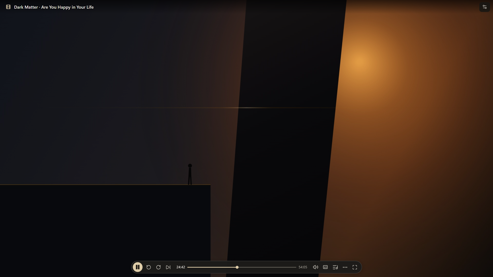
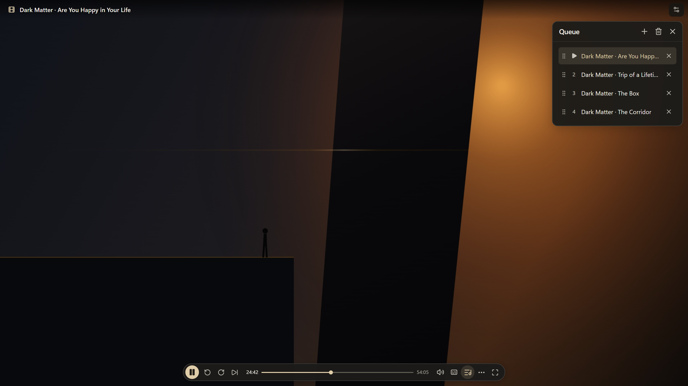
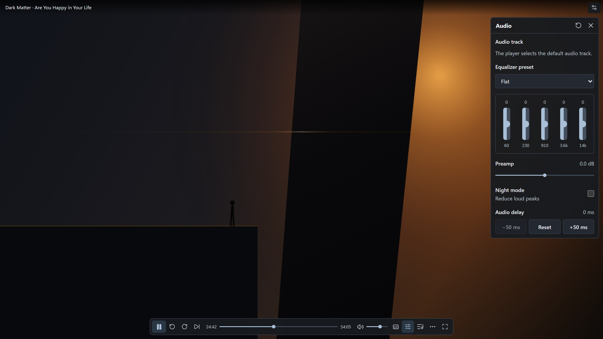
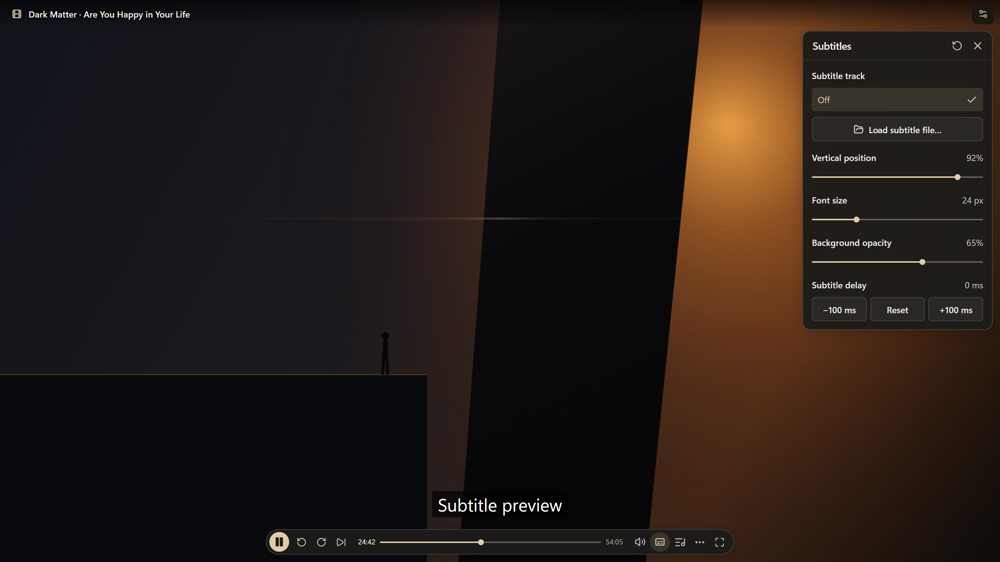
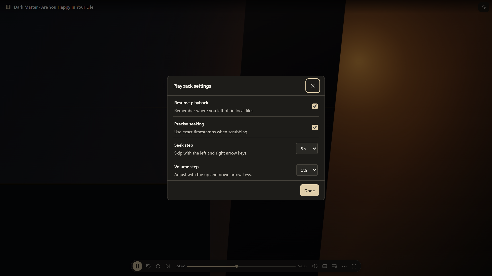

# MyPlayer Pro

MyPlayer Pro is a Windows x64 player for local video and music. The video fills the window, with a slim floating bar for playback and a queue, bookmarks, subtitles, and equalizer a click away. The desktop app uses Tauri 2 and Rust, with a React and TypeScript interface.

## Screenshots



| Playback queue | Equalizer |
| --- | --- |
|  |  |
| **Subtitles** | **Playback settings** |
|  |  |

[Start screen](docs/screenshots/00_open_player.png) · [Bookmarks and A–B repeat](docs/screenshots/07_bookmarks.png) · [Right-click playback menu](docs/screenshots/02_context_menu.png)

## Install and open files

Open [GitHub Releases](https://github.com/Ysh204/MyPlayer-rust/releases) and download the Windows x64 setup installer when available. The NSIS installer registers **MyPlayer Pro (Rust)** for `.mkv`, `.mp3`, `.m4a`, `.flac`, `.wav`, `.ogg`, and `.opus`. To set it as a default, right-click a file, choose **Open with** → **Choose another app**, select **MyPlayer Pro (Rust)**, and choose **Always**.

Open a file with **Ctrl + O**, drag it into the window, or open it from Explorer. A single click on the video leaves playback alone. Double-click to toggle fullscreen. The right-click menu includes playback speed, looping, and PNG frame capture.

## Playback and format support

- Hover over the timeline to preview a timestamp. Click the duration to switch between total and remaining time. Keyboard skips keep the controls hidden. Dragging previews the time and seeks directly to the chosen frame on release.
- Press **B** to bookmark the current position. Open **More actions → Bookmarks & loop** to jump to or remove a bookmark. For A–B repeat, choose **Set start**, play or seek to the other end, then choose **Set end**. **Clear** stops the repeat.
- Reopen one of the last three local files from **Recently played** on the start screen. **Clear** removes that list.
- Reorder files in the queue and resume local files from their saved position. Playback settings include seek and volume steps, precise seeking, and GPU video decoding. Restart the player after changing GPU decoding.
- Hover over **Audio track** in the playback menu to see the available tracks beside it. Track names wrap and include the language when tagged. You can also switch tracks in **Audio and equalizer**, where the list scrolls separately from the sound controls.
- Load external SRT, WebVTT, ASS, SSA, or MicroDVD SUB subtitles, or select embedded text subtitles from an MKV. Adjust subtitle size, position, background opacity, and timing.

The file picker accepts MP4, M4V, MKV, WebM, MOV, AVI, OGV, FLAC, MP3, M4A, WAV, OGG, and Opus. WebView2 renders video and handles ordinary single-track audio. On Windows, bundled libmpv handles audio for files with multiple inspected tracks and can play codecs such as E-AC-3 (Dolby Digital Plus), AC-3, DTS, and TrueHD when WebView2 lacks support. Video compatibility depends on WebView2. See [native decoder details](src-tauri/bin/README.md).

### Keyboard shortcuts

| Shortcut | Action |
| --- | --- |
| Space | Play or pause |
| Left / Right, or J / L | Seek backward or forward (5 seconds by default) |
| Up / Down | Adjust volume (5% by default) |
| M | Mute or restore the previous volume |
| B | Bookmark the current position |
| F or F11 | Toggle fullscreen |
| Ctrl + O | Open the media file picker |
| Esc | Dismiss the open menu or panel, or exit fullscreen |

## Develop on Windows

Install [Bun](https://bun.sh/), [Rust via rustup](https://rustup.rs/) with the stable MSVC toolchain, and the Windows dependencies in the [Tauri prerequisites](https://v2.tauri.app/start/prerequisites/#windows). These include the C++ desktop build tools and the WebView2 runtime.

From the repository root in PowerShell:

```powershell
bun install --frozen-lockfile
.\scripts\prepare_native_audio.ps1
bun run tauri dev
```

The preparation script downloads the pinned libmpv library, verifies it with SHA-256, and puts it in `src-tauri/bin/`. Git tracks the decoder documentation and license. The downloaded DLL is a local build input.

Use `bun run dev` for a browser preview of the interface. To check the frontend and run the Rust unit tests:

```powershell
bun run build
cargo test --manifest-path src-tauri/Cargo.toml
```

### Project layout

| Path | Contents |
| --- | --- |
| `src/features/` | Player, queue, equalizer, subtitles, and settings |
| `src/core/` | Tauri client, Web Audio processing, playback storage, and subtitle parsing |
| `src-tauri/src/services/` | Media inspection, subtitle extraction, and native audio decoding |
| `src-tauri/windows/` | NSIS file association hooks |
| `scripts/` | Decoder preparation, packaging, and screenshot tooling |

## Build a Windows release

With the development dependencies and decoder prepared:

```powershell
bun run tauri build --ci --bundles nsis msi
.\scripts\package_releases.ps1
```

Tauri writes the installers under `src-tauri/target/release/bundle/`. The packaging script copies the available installers for the build version and creates a portable ZIP under `releases/windows-x64/`. Extract the entire ZIP before running `MyPlayer-Pro.exe` so the executable can find its `bin/` folder. Use the NSIS installer if you want Windows file associations.

Local builds use the version in [the Tauri config](src-tauri/tauri.conf.json). When building with a version override, pass the same version to the packager with `-Version`. The [release workflow](.github/workflows/release.yml) prepares the decoder on a clean runner, builds the installers and portable ZIP, and publishes them to GitHub Releases for tags such as `v1.2.3`. A manual workflow run produces downloadable workflow artifacts.

## License

The project is MIT licensed. The bundled libmpv decoder is distributed separately under its [LGPL terms](src-tauri/bin/LICENSE.LGPL).
